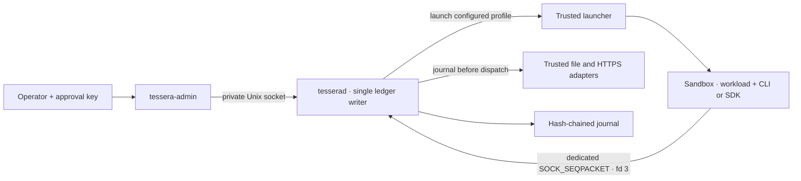

<p align="center">
  <picture>
    <source media="(prefers-color-scheme: dark)" srcset="docs/brand/tessera-lockup-dark.svg">
    
  </picture>
</p>

# Tessera

**Tessera is a Linux sandbox and capability broker for running workloads that you don't
trust with your files, network, or credentials.** Put a shell, an agent harness, or a
whole subprocess tree inside a sandbox. Give it permission to read one registered file
twice, make one request to a specific HTTPS service, or delegate part of an allowance to
a second sandbox. The broker accounts for each permitted attempt and gives the operator
a record of where the authority came from and how it was used.

Tessera is pre-release research software. The broker, launcher and adapters are
implemented. Verus checks an executable mirror of the authority core, and the hardware
FIDO2 path still awaits testing on a physical token.
[Verification status](#what-has-been-verified)

## Purpose and aims

Imagine a build agent that needs to read one diagnostic snapshot and ask a worker to
submit one report. The build agent needs a specific read, and the worker needs a bounded
HTTPS request. Tessera lets you grant those operations to separate Linux principals,
with separate lifetimes and an explicit allowance. Even a dependency running native code
inside the worker has to go through the same broker.

Linux confinement establishes the starting boundary. A sandbox gets a curated read-only
runtime, private writable storage and a dedicated broker channel. The broker mediates
the supported actions beyond that boundary. The operator chooses which files and
services are eligible, and a grant specifies **who** may do **what**, **how many
times**, **until when**, and **with what ability to pass it on**. New privileged root
grants go through an operator approval ceremony. The operator can also configure initial
baseline grants, which the ledger records with separate provenance.

The project aims to make authority small enough to reason about and explicit enough to
audit. Revocation cuts off future authorizations through a grant's subtree. A broker
restart ends the authority epoch, so recovering a journal can recover history without
making old grants usable again. The supported boundary is one Linux host and one trusted
operator, with protected file and HTTPS effects mediated by the broker.
[Specification](docs/specification.md) · [Threat model](docs/threat-model.md) ·
[Protected effects](docs/protected-effects.md)

## Try it on Linux

The reference host is Debian 13 on x86-64. The default launcher expects Linux 6.12 or
newer with Landlock ABI 6, bubblewrap 0.8.0 or newer, unprivileged user namespaces,
seccomp-BPF, and a delegated cgroup v2 subtree with the `cpu`, `memory`, and `pids`
controllers and `cgroup.kill`. The probe reports which mandatory controls it can
actually use on your host. The install guide covers running under systemd with
`Delegate=yes`. [Installation guide](docs/install.md) ·
[Kernel feature report](docs/kernel-feature-report.md)

Run the probe and demo from the repository root with Rust available through `rustup`.

```sh
cargo run --locked -p tessera-launcher --bin tessera-launch-probe
make demo
```

The demo creates a throwaway daemon configuration and file registry, starts a real
sandbox, and enrolls a **development software key**. The workload requests a one-use
read. The first read succeeds and the second is denied with `InsufficientBudget`. The
script walks through the audit log, revocation, emergency stop, and a restart against
the same journal. A `SKIPPED` result means the host could not run the sandbox
walkthrough. [Demo script](scripts/demo.sh)

In your own installation, with the daemon running, a launch profile configured and a
credential enrolled, the interaction looks like this.

| Where | Command | What happens |
|---|---|---|
| Operator | `tessera-admin register-file notes.txt --max-read 4096 --max-write 0` | Registers a named slot under the trusted file root and prints the object ID. |
| Operator | `tessera-admin create-principal agent` | Launches the configured profile as a fresh principal. |
| Sandbox | `tessera --json request --file 1 --rights read --budget 1 --depth 0` | Requests a one-use read of object `1` and waits for the operator. |
| Operator | `tessera-admin pending` | Shows the active ticket and normalized grant terms. |
| Operator | `tessera-admin approve 1 --key operator.key` | Reviews and signs ticket `1` using the enrolled development key. |
| Sandbox | `tessera read --cap "$CAP"` | Reads through the broker using the capability ID returned by the grant request. |
| Operator | `tessera-admin lineage "$CAP"` | Traces the capability back to its root authorization. |

Use the actual object and ticket numbers from your daemon. For a configured hardware
build, the admin CLI takes `--fido2 DEVICE` instead of `--key FILE`. The Rust SDK
exposes the same broker operations as the sandbox CLI.
[Operator commands](docs/operations.md) · [SDK and CLI](docs/sdk.md)

## Theoretical background and mathematical foundations

### Capabilities, identity and scope

In capability-based security, access follows from holding authority over a particular
object. In Tessera, a handle indexes a ledger record, and the broker separately
authenticates the sender on the socket assigned to its principal. The sender must own
the record to exercise it. Delegation creates a new child record for the recipient,
while transfer changes the owner of an existing record.

Let **O** be the set of canonical protected operations. A scope denotes a subset of
**O**, and the order on scopes is set inclusion. The concrete language uses a typed
resource ID and a small set of parameters. A file scope is a logical object ID and a set
of rights. An HTTPS scope is an endpoint ID, a set of methods and a maximum request-body
size. The adapter applies the registered resource's policy as well. Two file scopes with
different object IDs are incomparable.

Attenuation relies on the following implication. If a child scope is within its parent's
scope, every operation the child permits is permitted by the parent.

```text
is_subset(child, parent) ∧ permits(child, operation)
    ⇒ permits(parent, operation)
```

Containment composes along the lineage. Each derived capability has one immutable parent
and one root of provenance. Its creation-time terms capture the authority it received.
At delegation, the child's expiry can be no later than the parent's and its depth must
strictly decrease if the parent's depth is finite.
An owner may subsequently narrow the capability's scope, lifetime, depth or balance.
Existing children keep their own terms, and recursive revocation is the operation that
cuts off an entire subtree.
[Formal authority model](docs/specification.md#4-formal-authority-model) ·
[Scope implementation](crates/capability-core/src/scope.rs)

### Budgets as affine resources

A one-use authorization is **affine**. You can use it once or leave it unused. For
finite budgets, delegation moves units out of the source balance and into a child
balance. If a parent has five units and delegates two, the parent has three and the
child has two. The combined balance is still five. Within a finite pool, allocations
form a partial commutative monoid under addition. Zero is the identity, and a collection
of balances can be combined only if their sum fits within the pool.

Each authorized operation costs one attempt. A failed or uncertain dispatch consumes the
unit already reserved for it. A finite grant can create only finite children. An
unlimited grant may create a finite child, which starts a new conserved pool. Budget and
delegation depth are independent. A capability with an unlimited budget can still have
depth zero.

Tessera exposes the same accounting identity for every finite pool.

```text
N = U + L + D

N  initial allocation
U  units consumed by reservations
L  units still held by live capabilities
D  units explicitly discarded or stranded in non-live capabilities
```

The stored invariant is
`initial = consumed + explicitly_discarded + sum(member_balances)`. Splitting
redistributes member balances. Reserving an attempt moves one unit into `consumed`.
Dropping a balance or reducing it by attenuation moves units into `explicitly_discarded`. Expiry, revocation, owner termination and an epoch change can strand a balance. The
accounting query derives **L** and **D** at a given tick from liveness, so stranded
units stay visible without becoming spendable again.
[Accounting implementation](crates/capability-core/src/lib.rs) ·
[Proof register](docs/proof-register.md)

### The state machine

The core is a deterministic Rust state machine with one authority-changing entry point,
`step(&mut state, authenticated_command, tick)`. The caller and trusted monotonic tick
are explicit inputs. The core validates a command and plans its mutation before applying
it. A denial leaves the ledger unchanged. The state records principals, capabilities,
roots, finite pools, spent nonces, reservations and request bindings, along with the
epoch, sequence and clock. A capability records its current terms and immutable creation
terms, owner, parent, root and status.

| Transition | Ledger effect |
|---|---|
| **Mint** | Redeem a fresh approval nonce and create a root with the exact approved terms. Operator-installed baselines use a separate transition and provenance. |
| **Consume** | Check owner, liveness, scope and budget. Deduct one finite unit and issue a reservation bound to the exact operation and request ID. |
| **Split / delegate** | Create an attenuated child for the same owner or a recipient. Move the finite allocation atomically. Each edge uses one finite delegation generation. |
| **Attenuate** | Narrow an existing capability's terms and account for any discarded balance. |
| **Transfer** | Move ownership of the same capability to an active principal and decrement finite delegation depth. Preserve its identity and lineage. |
| **Drop / revoke** | Drop discards the owner's remaining balance and leaves descendants intact. Revoke prevents new uses of the target and its descendants. |
| **Terminate / bump epoch** | Termination disables an identity. An epoch bump disables every earlier principal and abandons unresolved reservations while retaining history, spent nonces and monotonic ID allocation. |

A usable capability belongs to an active principal in the current epoch, has yet to
expire, and has no revoked ancestor. A parent's exhausted balance or its owner's
termination leaves already delegated authority in other live principals intact. The
broker also manages a separate *spawn tree* for sandbox lifecycle. Terminating a
principal cascades to the sandboxes it spawned.
[Core transitions](crates/capability-core/src/step.rs) ·
[Semantic decisions](docs/proof-register.md#semantic-decisions-spec-ambiguities-resolved)

## Capability passing in practice

Capability passing lets one sandbox give another sandbox a piece of authority it
already has. Suppose the operator grants a coordinator five snapshot attempts on file
object 1, with depth 1 and five minutes remaining. A worker needs two attempts and has
no reason to pass them on. The coordinator can delegate two attempts on the same object
at depth 0, with an expiry inherited from its own grant.

```sh
tessera delegate --cap "$PARENT_CAP" --to "$WORKER" \
  --file 1 --rights read --budget 2 --depth 0 --expiry inherit
```

The broker checks the coordinator's ownership and the worker's identity. In one ledger
transaction it subtracts two units from the coordinator and installs a fresh child
capability owned by the worker. The worker can find it with `tessera list` and can spend
its two attempts independently. The coordinator keeps three. Each record keeps its
provenance, so the coordinator or operator can revoke the parent and close off future
uses through the child. A worker can also receive the existing capability through
`tessera transfer`, which moves its full remaining balance and leaves the coordinator
without ownership of that record. A copied handle can tell the worker which record to
look for. The ledger transaction is what gives the worker authority to use it.

### What the grade means

Linear logic treats assumptions as resources and controls *contraction*, the rule
that would duplicate one. Affine logic permits *weakening*, so a resource may go
unused. Bounded linear logic gives the exponential a quantitative index. For example,
`!₂ A` expresses an upper bound of two uses of `A`.
[Quantitative Program Reasoning with Graded Modal Types](https://hde.design/includes/pubs/ICFP19.pdf)

Tessera uses a similar reading for operational authority. For permission scope `P`,
read `P[n]` as up to `n` attempts within `P`. Each rule below has a concrete counterpart
in the ledger.

| Resource rule | Broker behavior |
|---|---|
| Split a finite grade `5 = 3 + 2` | Keep three attempts under `P` and delegate two under a scope contained in `P`. |
| Spend one use | Reserving an exact operation under a finite `P[n]` leaves `n - 1` units. The reservation commits before the effect. |
| Weaken authority | Drop an unused balance, or narrow scope, budget, lifetime or delegation depth. |
| Bound structural duplication | A second holder can receive an explicit allocation from an existing balance. Copying a handle creates neither a second balance nor a second owner. |

The grade counts *attempts*. Scope, lifetime and delegation depth constrain what those
attempts can authorize and how the grant may be passed on. An unlimited grade is an
explicit grant choice. A finite child carved out of an unlimited grant starts its own
conserved pool. Tessera realizes this discipline at runtime with authenticated callers,
ledger transitions and durable reservations. Its formal model describes those
transitions and their invariants. [Budget model](docs/specification.md#42-budgets-as-affine-resources)
· [Delegation rules](docs/adr/0013-delegation.md) · [CLI and SDK](docs/sdk.md)

## Architecture and implementation



### Linux confinement and local IPC

The launcher uses bubblewrap namespaces, a curated read-only mount layout, a seccomp-BPF
filter, Landlock and cgroup v2. A small init shim applies Landlock, closes inherited
descriptors beyond the standard streams and broker channel, and confirms confinement
before it executes the workload. Every principal gets a fresh directory beneath its
profile's configured workspace parent. The daemon excludes its state directory,
protected file root and admin socket from mounts. The launcher can stop the whole
sandbox tree through `cgroup.kill`. Required controls fail closed, with explicit
configuration for supported opt-outs.

The launcher and broker bind one `SOCK_SEQPACKET` socketpair to each sandbox. The broker
takes caller identity from that channel. The sandbox's fd 3 can be inherited by
subprocesses in the same principal. On the agent channel, the broker rejects ancillary
data and enforces bounded, canonical protocol v2 messages. Per-principal rate and
in-flight limits protect the single writer. The separate operator socket is mode `0600`
and checks the broker UID with `SO_PEERCRED`. Agent-initiated spawn is restricted to
operator-listed profiles and quotas. The child receives the profile's configured
baseline, and any additional authority arrives through explicit delegation or a new
approved grant. [Launcher](crates/launcher) · [Protocol](crates/protocol) ·
[Broker hardening](docs/adr/0024-broker-hardening.md)

### Approval, provenance and dispatch

The broker normalizes a grant request into a canonical payload containing the
installation, epoch, operator, recipient, scope, budget, depth, grant expiry, a fresh
nonce and an approval deadline. The admin CLI checks that the operator's rendered
request matches the challenge. An agent's description is escaped, demarcated and
excluded from the signed terms. Approval uses a domain-separated digest and the enrolled
FIDO2 credential. The verifier checks the signature, relying party and signed
user-presence flag, with optional user verification. The operator can narrow the request
before signing. The broker presents one active prompt at a time and rotates among queued
principals, with per-principal limits and a deadline for each request. The mint and nonce
redemption become durable together.
[Approval crate](crates/approval) ·
[Approval specification](docs/specification.md#8-human-authorization-and-trusted-approval)

For a protected operation, the single writer validates against committed state, appends
and syncs the consume transition, and applies the state change. It syncs a dispatch
marker before giving the reservation to a worker. The worker reports the result to the
writer, which journals the outcome before replying. A matching retry with the same
request ID can recover the reservation's status. A different request under the same ID
conflicts. The ordering also defines what revocation means. A revoke that commits first
prevents a later reservation through that subtree. An earlier reservation may still
dispatch or finish. [Broker](crates/broker) · [Journal](crates/journal) ·
[Budget and retry semantics](docs/adr/0012-budget-semantics.md)

### File and HTTPS effects

| Adapter | What the grant addresses | What the adapter enforces |
|---|---|---|
| File | A registered logical slot with snapshot and/or replacement rights. | Holds a trusted directory FD and opens the registered leaf with `openat2` resolution constraints. Checks identity, ownership, file type, link count and size. Returns bounded snapshot bytes. Replacement syncs the new file and uses an atomic exchange. The journal records both identities before the exchange so recovery can re-register a verified occupant. |
| HTTPS | A registered endpoint, allowed HTTP methods and a request-body bound. | Uses the operator's host, port, path prefix, header policy, size limits and deadline. Validates the destination address and TLS identity. Can inject a broker-held credential header. Each reservation allows one HTTP/1.1 attempt on a fresh TLS connection, with redirects returned to the client and no automatic retries. |

On recovery, a dispatch with a durable marker and no outcome is uncertain. The broker
reports it for reconciliation and forbids re-dispatch. File slot recovery may make a
verified file available to new grants while the original reservation stays uncertain.
The write-ahead log is the source of truth for replay. The separate audit log records
decisions, identifiers and lineage for operators. An off-host checkpoint lets an
operator verify the audit chain's recorded prefix. [File adapter](adapters/file) ·
[File identity and recovery](docs/adr/0019-file-object-identity.md#replacement-recovery)
· [HTTPS adapter](adapters/https) · [Operations](docs/operations.md)

## What has been verified

| Layer | Evidence | Boundary |
|---|---|---|
| **Verus model** | The pinned Verus run reports **173 verified, 0 errors** on the mirror. It checks stored pool conservation and no overspend, scope containment through ancestry, finite depth, nonce uniqueness and exact mint terms, no state change on denial, and the soundness of core liveness and consume authorization. It covers every transition, including epoch compaction (ADR-0031). For compaction it checks exact pruning of earlier-epoch records, kept spent nonces and id counters, unchanged liveness, no dangling references, and retired-pool and global conservation. | The proof applies to an executable mirror in `proofs/`. The liveness-based accounting split, production invariant checker, and surrounding system have separate evidence. |
| **Production Rust core** | The same Verus run also checks the production source of the pure leaf functions in `budget.rs`, `scope.rs` and `ids.rs`, including `permits`, `is_subset` and subset soundness: **63 verified, 0 errors**. A differential harness compares each command's result and observable state with the mirror, including compaction. Property tests also compare against an independent reference model. The executable invariant checker covers ledger relationships such as reservation counts and pool accounting. | The production ledger (`state.rs`, `step.rs`) is not verified directly. Its correspondence with the mirror is tested. |
| **Broker protocol model** | A Python explicit-state checker and a TLA+ model run bounded commit, dispatch, revoke and crash schedules. The models check properties including no double-spend, dispatch only after durable commit, and no replay after restart. | The models abstract storage and adapters. Kernel behavior, UI behavior and torn writes have separate evidence. |
| **Runtime and recovery** | Broker, journal, adapter and SDK tests cover ordering, fault injection, software-key approval and protocol handling. Linux integration tests and the hostile-shell corpus exercise confinement on a suitable host. Fuzz targets cover core transitions and decoders. | The Linux kernel, trusted launcher, broker, adapter and storage assumptions remain part of the security argument. Hardware FIDO2 awaits physical-token testing. |

The Verus mirror attaches preconditions, postconditions and mathematical state
predicates to executable functions. Each successful transition must preserve the
invariant from its pre-state. The proof follows the transitions. Creating a pool
establishes its initial balance, delegation redistributes it, and consuming or
discarding units changes which account holds them. The differential harness compiles the
mirror with proof annotations erased and compares it with the production implementation
after each command. [Proof register](docs/proof-register.md) ·
[Mirror correspondence](proofs/README.md#correspondence-with-the-production-core) ·
[Protocol model schedules](models/README.md)

```sh
make test
make models
make tlc
make verus
cargo test --release --locked --manifest-path proofs/Cargo.toml
```

TLC requires Java. The Verus runner obtains a pinned release on first use. Real-sandbox
tests require the kernel controls reported by the launcher probe.
[Contributing and test prerequisites](CONTRIBUTING.md)

## Scope and limitations

- **The host is trusted.** A hostile host administrator or compromised kernel is outside
  the boundary. The security argument also depends on the operator's resource
  registration, correctly functioning confinement, and durable storage.
- **Grants compose into real communication channels.** A process that can read protected
  data and submit to an HTTPS endpoint may disclose that data. A holder can also act as
  a deputy for another process through an allowed channel, including when direct
  delegation is disabled. Revocation applies to future authorizations, and data already
  delivered remains available to its recipient.
- **One attempt has an uncertain edge.** A remote endpoint may have acted before a
  connection failed. Tessera retains the uncertain outcome and leaves remote
  reconciliation to the operator.
- **Ledger capacity is finite within an epoch.** Per-principal and per-root quotas limit
  how many records one workload or grant tree can allocate. At each restart the broker
  journals a compaction that prunes earlier-epoch records. Spent nonces and ID counters
  survive it, and pruned pools stay in the conservation accounting. The journal file
  itself is never rewritten, so replay time grows with total history.
  [Epoch compaction](docs/adr/0031-epoch-compaction.md)
- **The model API is a disclosure channel.** In compatibility mode an unmodified harness
  reaches its model provider only through a host-side proxy that holds the credential.
  That channel is unlimited-use, and anything the agent can read can be sent to the
  provider. [Compatibility mode](docs/compat.md)
- **Not release-ready yet.** The core hardware-key approval test passed with a
  YubiKey 5. A few manual hardware checks and an independent human security review are
  still outstanding. [Release gates](docs/release-gates.md)
- **A key touch authenticates presence.** The operator's understanding of the grant
  depends on the trusted display and the terms they review.
- **The active enforcement path is broker-only.** The BPF LSM direct-grant prototype is
  research. [BPF LSM evaluation](docs/bpf-lsm.md)

The independent review records the findings and their remediation status.
[Threat model](docs/threat-model.md) ·
[Security review](docs/security-review-2026-11-25.md)

## Explore the repository

| If you want to… | Start here |
|---|---|
| Operate a daemon or write a profile | [Installation](docs/install.md) · [Operations](docs/operations.md) |
| Integrate a workload | [SDK and CLI](docs/sdk.md) · [Swarm example](crates/sdk/examples/swarm_demo.rs) |
| Run an existing harness (Claude Code, Codex) unmodified | [Compatibility mode](docs/compat.md) · [Examples](examples/compat) |
| Follow the design or audit a claim | [Specification](docs/specification.md) · [Architecture decisions](docs/adr/README.md) · [Traceability](docs/traceability.md) |
| Review build and test evidence | [Release engineering](docs/release.md) · [Contributing](CONTRIBUTING.md) · [Security reporting](SECURITY.md) |
| Complete the hardware and human-review release gates | [Release gates](docs/release-gates.md) |

The logo's separated tile represents a delegated allocation. Its dashed outline marks
the place from which that allocation was taken. The piece still counts in the ledger.
[Brand decision](docs/adr/0009-project-name-and-brand.md)

## License

Apache-2.0.
