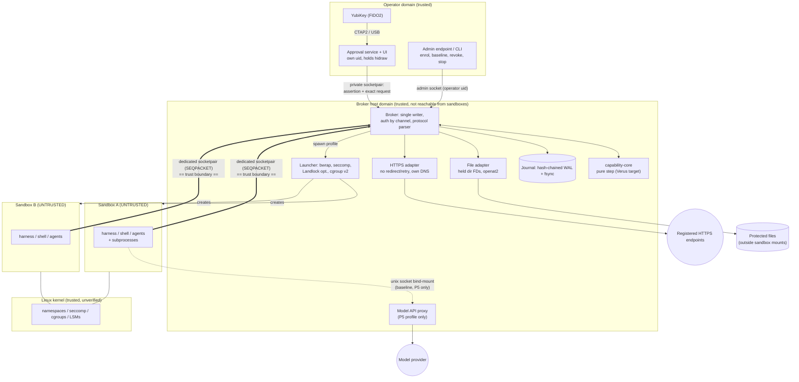

# Tessera threat model (WP0 design freeze)

Status: **design frozen for the MVP (P0–P5)**. Nothing here is implemented or
verified. This document turns specification §1.1 and §2 into concrete
statements. The protected-effect inventory is in
[`protected-effects.md`](protected-effects.md). Decisions are in
[`adr/`](adr/README.md). The mapping of requirements and theorems to
artifacts is in [`traceability.md`](traceability.md).

## 1. System under consideration

The MVP has:

- one Linux host (ADR-0018) and one trusted operator with one enrolled
  FIDO2 credential
- one broker process: the single-writer ledger (ADR-0001), the journal
  (ADR-0002) and the file and HTTPS adapters
- one approval service (ADR-0006, ADR-0017) and one trusted launcher
  (ADR-0005)
- two or more untrusted sandboxes, each a separate principal with its own
  socketpair to the broker (ADR-0004)

## 2. Assets

| ID | Asset | Why it matters |
|---|---|---|
| A1 | Registered protected files (logical slots, ADR-0019) | Confidentiality and integrity of operator data |
| A2 | Registered HTTPS endpoints and the effects of requests to them | External side effects, possibly costly or irreversible |
| A3 | Broker-held credentials (HTTPS secrets, model API key) | Lead to unbounded authority if leaked |
| A4 | The authority ledger and journal (balances, lineage, spent nonces, request log, epoch) | Corrupting them creates or resurrects authority |
| A5 | The FIDO2 authenticator, its enrolment record and the approval UI channel | The root of all new privileged authority |
| A6 | Other sandboxes' processes, memory, channels and workspaces | Separation between principals |
| A7 | Host integrity: confinement configuration, kernel interfaces, host files, devices, sockets | A bypass defeats everything else |
| A8 | Audit trail | Accountability (R8), and the evidence behind incident response |
| A9 | Host availability (CPU, memory, PIDs, disk) | Secondary; DoS is in scope only as far as cgroup limits go |

## 3. Adversary

As in spec §2.1. **Everything inside a sandbox is hostile**: the model,
harness, plugins, tool output, dependencies, subprocesses and other agents.
The adversary can:

- run arbitrary native code (any syscall the seccomp filter allows, any
  binary in the read-only runtime, or binaries it builds in its workspace)
- forge, replay, reorder, flood and malform IPC frames on its own channel;
  send ancillary data; race many requests concurrently
- copy capability IDs and request IDs to other agents, and reuse request
  IDs
- trigger broker restarts, for example through resource pressure or
  malformed input aimed at crash bugs, and act at any moment around a crash
- manipulate paths, symlinks and renames inside its own workspace, and try
  to reach host files through aliases (`/proc`, inherited FDs, bind mounts)
- try to obtain inherited descriptors, other sandboxes' channels, the
  authenticator or the approval UI
- cooperate with other hostile sandboxes through any channel this document
  allows (§7)
- write deceptive free text in grant requests to mislead the operator

The adversary **cannot** (assumptions): break the cryptography (SHA-256,
ECDSA P-256 and Ed25519 as implemented in pinned RustCrypto crates; TLS via
rustls); physically touch the authenticator; control the operator's
keyboard or display outside the sandbox; or exploit the kernel. A kernel
exploit is a residual risk (R-3), not a defended case.

## 4. Trusted computing base

| Component | Trust | Notes |
|---|---|---|
| Linux kernel and its configuration (namespaces, seccomp, cgroup v2, Landlock if enabled) | Trusted, unverified | Pinned per ADR-0018. Bugs are residual risk R-3 |
| Hardware and firmware, including the storage fsync semantics | Trusted | ADR-0002 assumption |
| Launcher (`crates/launcher`) and pinned `bwrap` | Trusted | Must activate every restriction before exec |
| Broker (`crates/broker`), journal (`crates/journal`), protocol parser (`crates/protocol`) | Trusted; partially verified later | The parser is the first code to touch hostile bytes |
| Authority core (`crates/capability-core`) | Trusted; intended to be Verus-verified (ADR-0008) | A function-by-function mirror is Verus-verified (`proofs/`). The production crate is linked to it only by a differential test (proof register A13). |
| Adapters (`adapters/file`, `adapters/https`) | Trusted per adapter | Must refine the reservation model (T11) |
| Approval service and UI (`crates/approval`), libfido2 transport | Trusted | libfido2 is trusted for transport and availability only, not for acceptance (ADR-0006) |
| RustCrypto, rustls, hyper and other pinned crates | Trusted, unverified | Supply-chain risk R-9 |
| Operator and administrative endpoint | Trusted | Hostile admin is out of scope (R-4) |
| Verification and build toolchain (rustc, Verus `0.2026.11.02.8bf68ee` with bundled Z3, Python model checker) | Trusted | |
| Model API proxy (P5 profile only, ADR-0020) | Trusted | New component; needs review |
| SDK, CLI client code inside sandboxes, harnesses | **Untrusted** | |

## 5. Trust diagram

The trust boundaries are:

- **TB1**: the sandbox channel to the broker. All bytes crossing it are
  hostile.
- **TB2**: the kernel interface around each sandbox (the syscalls that
  seccomp allows inside its namespaces).
- **TB3**: the approval UI and the authenticator. This boundary is
  reachable only by the operator.
- **TB4**: the adapters' outbound side (remote servers and the file system
  are not trusted to behave exactly-once).
- **TB5**: the model API proxy (P5).

## 6. Security objectives (conditional)

The objectives below hold only if all of these conditions are true:

- the launcher establishes the confinement in ADR-0005 correctly
- every protected effect is mediated as in `protected-effects.md`
- the caller and object mapping is sound (ADR-0004, ADR-0019)
- the journal is durable (ADR-0002)
- the cryptographic assumptions hold
- the adapters refine the reservation model

Under those conditions:

1. A protected effect happens only with a committed reservation from a live
   capability that the caller owns (or a direct baseline witness). That
   capability derives from a FIDO2-approved root or from the recorded
   operator baseline (R2, R3, T3, T11).
2. Finite budgets are conserved: `N = U + L + D`. Attempts ≤ N. Failures do
   not refund (R4, T1).
3. Delegation never amplifies scope, budget, expiry or depth (R5, T2, T4).
4. Revocation is prospective and ordered by commit sequence (R6, T5).
5. Restart never resurrects authority and never replays an uncertain effect
   (R9, T10).
6. Unsupported enforcement fails closed (R10).

Nothing here is a claim of information-flow control, exactly-once remote
effects, or confinement against kernel bugs.

## 7. Allowed communication (spec §9.1: "document all allowed communication")

| Channel | Between | Allowed? | Notes |
|---|---|---|---|
| Broker socketpair | sandbox ↔ broker | Yes | Only path to authority. Ancillary data rejected |
| Shared files or mounts | sandbox ↔ sandbox | **No** (MVP) | Each workspace is private. No common writable mount |
| Unix sockets, abstract sockets, SysV/POSIX IPC | sandbox ↔ sandbox | No | Separate net and IPC namespaces |
| Signals, ptrace, `/proc/<pid>`, pidfd | sandbox ↔ sandbox | No | Separate PID namespaces; seccomp denies ptrace |
| Protected files through the file adapter | sandbox → file → sandbox | **Yes, if both hold grants on the same slot** | A write by A and a read by B is a deliberate channel (deputy risk R-1) |
| HTTPS endpoints | sandbox → remote → sandbox | **Yes, if both hold grants** | A remote server can relay data between agents |
| Model API (P5) | sandbox → provider | Yes, baseline | Disclosure channel R-2. Two agents on the same provider account could relay through shared state (for example files or threads APIs) if the endpoint exposes it |
| Broker side channels (timing, denial responses, Inspect) | sandbox ↔ sandbox | Limited | Inspect shows only the caller's own capabilities. Timing and covert channels are not closed (R-6) |
| Operator | any | Social | Agents can try to persuade the operator through request text (R-5) |

## 8. Residual risks (accepted, documented, not mitigated by the MVP)

| ID | Risk | Why it remains | Partial mitigation / where tracked |
|---|---|---|---|
| R-1 | **Confused or colluding deputy.** A non-delegatable grant stops direct transfer. It does not stop the holder from acting *on behalf of* another agent that asks it to, through any allowed channel (§7). | Non-delegation is a property of the ledger. Intent is not observable | Document per profile which channels exist. The spec §15 test "authorized agent proxies for another" must document the outcome. Claims say "no direct transfer", never "only A benefits" |
| R-2 | **Information flow through the model API and adapters.** An agent that can read protected bytes and talk to a model API or an HTTPS endpoint can disclose them. A read cannot be revoked after it happens. | No information-flow policy in the MVP (spec §1.1 non-goal) | Do not combine protected reads with model or network access in the same principal unless that is acceptable. Bounded response sizes. Audit digests. Future: IFC research (§16) |
| R-3 | **Kernel in the TCB.** A kernel bug (namespaces, seccomp, io_uring, eBPF, filesystem) defeats confinement. | No custom or verified kernel; spec non-goal | Minimal seccomp allow-list. Deny io_uring, bpf, userfaultfd, perf. Pinned kernel. Disposable VM for hostile tests. VM option for high-risk work |
| R-4 | **Hostile host administrator / root.** Root can rewrite the journal (including the whole hash chain), roll back storage, replace binaries or read memory. | Spec non-goal | The hash chain detects accidental corruption and tampering relative to an *externally retained* head checkpoint only. Anti-rollback would need external or hardware state |
| R-5 | **Approval is presence, not consent.** The YubiKey has no display. The operator may approve a misleading request or develop approval fatigue. | §8.2 | Only normalized fields are shown. Agent text is labelled untrusted. One outstanding request. Rate limits. Deny by default on timeout |
| R-6 | **Covert and timing channels** between sandboxes through the shared CPU, cache, broker latency and the clock. | Not addressed by namespaces | Out of scope. Do not claim non-interference |
| R-7 | **In-flight effects after revocation.** A reservation committed before a revoke may still be dispatched after it (§5.2, ADR-0014). | Cancellation needs adapter protocols | The audit labels it "authorized before revocation". Shown in model traces |
| R-8 | **Remote effects are not exactly-once.** An uncertain attempt (crash, timeout) may or may not have reached the server. It is reported as `unknown` and never retried. | §5.2 | No adapter retries (ADR-0007). Remote idempotency keys are future work |
| R-9 | **Supply chain and toolchain.** Pinned crates, bwrap, libfido2, rustc and Verus are trusted. | | Pinning, SBOM, minimal privileged deps (WP8) |
| R-10 | **Storage lying about durability.** A volatile write cache or a firmware bug can lose acknowledged records, which could resurrect authority. | ADR-0002 assumption | Fault-injection tests. Document the supported storage. Fail closed on fsync error |
| R-11 | **Broker and launcher as new privileged attack surface** (§12.4). A parser bug could crash or compromise the broker. | Inherent | Bounded framing before parsing. No unsafe code in the core. Fuzzing (WP3). Restart fails closed |
| R-12 | **Denial of service.** A sandbox can exhaust its own quota, flood the approval queue, or trigger restarts. A restart kills *all* sandboxes (ADR-0003). | Availability is secondary | cgroup limits. Per-channel rate limits. Approval rate limits |
| R-13 | **Unmediated baseline effects** (see `protected-effects.md` §3) are not capability-controlled. | Needed to run a workload | Each is listed and must not reach a protected resource |
| R-14 | **Harness compatibility gaps.** Unmodified harnesses may fail, or users may be tempted to widen the baseline. | R12 is SHOULD | A baseline change is an authenticated admin transaction and invalidates sessions (§8.2) |
| R-15 | **Provider-side tools as egress.** Through the model route, an agent can ask the provider to reach arbitrary hosts on its behalf: Anthropic `mcp_servers` and web fetch/search tools, or OpenAI Responses `mcp` (`server_url`) and `web_search` tools. | The proxy forwards to one host; what that host does next is outside the sandbox | The model proxy's JSON body policy refuses `mcp_servers` and server-side `tools[].type` (on in the shipped examples), and filters the request headers and `anthropic-beta` values through allowlists. This is defence in depth that depends on provider API shapes: new provider features are not caught. Also disable server-side tools on the provider account (`docs/compat.md`) |
